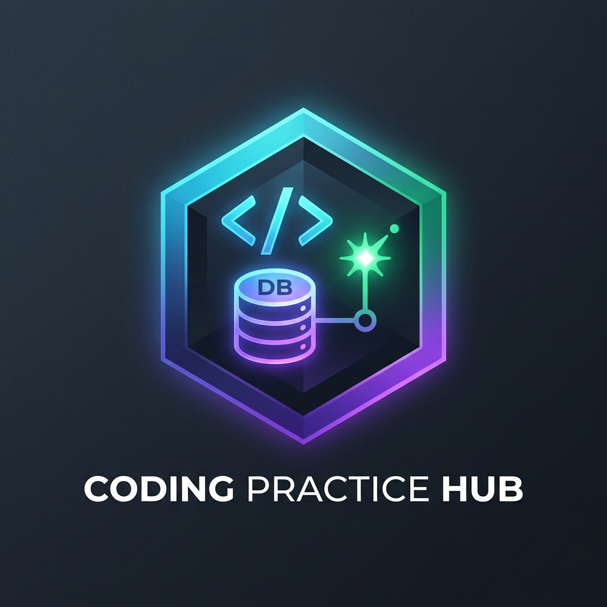

<p align="center">
  
</p>

# 🚀 Coding Practice Hub

> **A Complete Local Daily Coding & Interview Practice Web Application**  
> Practice **SQL**, **Python**, **PySpark**, **Databricks**, **DSA**, and **System Design** with real code execution, DuckDB analytical engine, multi-file Python project workspace, multi-database management, Monaco editor, execution history, and streak analytics.

---

## 🌐 Local Application URLs

Access your local application at port `5000`:

👉 **[http://localhost:5000/](http://localhost:5000/)**  
*(Alternative loopback: [http://127.0.0.1:5000/](http://127.0.0.1:5000/))*

### 🗺 Application Routes

| Section | Localhost URL | Description |
| :--- | :--- | :--- |
| **🏠 Dashboard** | [http://localhost:5000/](http://localhost:5000/) | Overview, 8 KPI cards, 6/6 daily progress & streak tracking |
| **💻 Practice Workspace** | [http://localhost:5000/practice](http://localhost:5000/practice) | Full-width Monaco Editor, multi-file workspace, console output & live execution |
| **📜 Practice History** | [http://localhost:5000/history](http://localhost:5000/history) | Calendar & table history, multi-criteria filters & grouping |
| **📊 Datasets Manager** | [http://localhost:5000/datasets](http://localhost:5000/datasets) | Upload CSV/JSON/Parquet, DuckDB table explorer & code snippets |
| **📈 Reports & Analytics** | [http://localhost:5000/reports](http://localhost:5000/reports) | Performance charts, completion/success rates, & activity trends |
| **⚙️ Settings & Backup** | [http://localhost:5000/settings](http://localhost:5000/settings) | Environment status, execution timeouts, & 1-click backup/restore |

---

## ⚡ Quick Start & Running the App

### Option 1: 1-Click Windows Launcher (Auto-opens browser)
Double-click **`run.bat`** in the project folder. It will start the server and automatically launch **[http://localhost:5000/](http://localhost:5000/)** in your browser.

### Option 2: Via Terminal / PowerShell
```powershell
python app.py
```
Then open: **[http://localhost:5000/](http://localhost:5000/)**

---

## 💻 Layout & Navigation Features

### 1. Left Vertical Sidebar (Maximized Screen Height & Collapsible)
- **Top Navbar Replaced with Left Sidebar**: Eliminates the top navbar to free up the full vertical height of the screen (100vh) for code editing and result inspection.
- **Collapsible Mini-Sidebar**: Click the `◀` / `▶` toggle button on the sidebar to collapse it into a compact 68px icon-only mode, maximizing horizontal screen space for wide monitors or split-screen coding.
- **Flicker-Free Persistent State**: User preference is stored in `localStorage` and initialized synchronously during parsing before first paint. When refreshed in minimized mode, it renders directly in minimized state without opening and auto-collapsing. Smooth transitions are enabled strictly during interactive toggle clicks.
- **Integrated Daily Practice Targets (On the Side)**:
  - Date picker and daily session progress badge (`0 / 6`).
  - Vertical list of all 6 daily practice targets (SQL, Python, PySpark, Databricks, DSA, System Design) with live status dots (Completed, In Progress, Not Started).
  - Keeps the top workspace header clean, uncluttered, and free of button collisions.
- **Integrated Sidebar Utilities**:
  - Prominent brand header with full title visibility and dedicated single `◀` / `▶` collapse toggle (clean, uncluttered layout without disturbing double icons).
  - Navigation links (Dashboard, Practice, History, Datasets, Reports, Settings).
  - Quick Search trigger button (`Ctrl + K`).
  - Dedicated bottom theme selector and local server status.

### 2. App-Level Theming (System Default, Light, Dark, Grey)
- **4 Theme Choices**:
  - **🖥️ System Default**: Dynamically tracks your operating system's color scheme preferences (`prefers-color-scheme`) and switches automatically.
  - **☀️ Light Theme**: Crisp, clean, high-contrast light theme with white editor, subtle borders, and dedicated light-mode emblem.
  - **🌙 Dark Theme**: Deep navy/slate developer dark theme with rich visual hierarchy and glowing cyber emblem.
  - **🩶 Grey Theme**: Modern zinc/charcoal dark theme (inspired by Zed and JetBrains Fleet) with metallic emblem.
- **Theme-Adaptive Logo & Icon Background Across Sidebar and Main-Content**:
  - Switching themes dynamically swaps all logo instances across the **Sidebar** and **Main-Content** (Dashboard header, Practice workspace header, History, Datasets, Reports, and Settings), as well as the browser favicon, between `logo-light.png`, `logo-dark.png`, and `logo-grey.png`.
  - Icon container backgrounds, borders, and shadows adapt automatically via `--logo-bg`, `--logo-border`, and `--logo-shadow` CSS variables so the emblem blends natively without dark square artifacts in light mode.
  - Synchronous pre-paint initialization ensures instant display on page refresh without flicker.
- **Live Monaco Synchronization**: Theme switches instantly update Monaco Editor between `vs` and `vs-dark`, and persist across browser sessions in `localStorage` and backend settings.

### 3. Fullscreen & Maximize Editor (70% Editor + 30% Output Console)
- **⛶ Normal Browser Fullscreen**: Click the `⛶ Fullscreen` button in the editor tab bar / practice workspace actions (or press `F11`) to expand the app into true edge-to-edge browser fullscreen mode.
- **🗖 Maximize Editor & Console**: Click the `🗖 Maximize` button to isolate the coding environment into distraction-free focus mode. Unlike legacy focus modes that hide the console, this mode cleanly allocates **70% of screen height to the Monaco Editor** and **30% to the Output Console**, allowing you to code and inspect execution results simultaneously. The vertical resizer handle remains fully interactive.
- **Universal Escape (`Esc`) Handler**: Pressing `Escape` naturally exits fullscreen modes in clean priority:
  1. Closes any open modal dialog (Explorer, Create Database, Confirm, History).
  2. Restores the editor from Maximized Mode to standard view.
  3. Exits edge-to-edge browser fullscreen mode.

### 4. Zero Browser Popups (Custom In-App Modal Dialogs)
- **No Native `alert()`, `confirm()`, or `prompt()`**: All destructive confirmations and database creations use sleek in-app modals (`#app-confirm-modal` and `#create-db-modal`).
- **Confirmation Modals**: Destructive operations (resetting workspace code, deleting custom project files, removing uploaded datasets, restoring backups) use sleek modal dialogs with customizable confirmation and cancellation buttons.

### 5. Multi-File Project Workspace & Folder-Wise Files Explorer for ALL Editors
- **Universal Multi-File Tabs**: Practice real-world file structures directly in the browser across **all 6 technologies** (SQL, Python, PySpark, Databricks, DSA, and System Design).
- **Remove Tab vs Permanent Delete**:
  - **Closing Tabs (`×`)**: Clicking `×` removes the tab from the active editor view without deleting the file from disk or the workspace. The file remains safely saved and can be reopened anytime.
  - **Permanent Deletion**: Destructive deletion is accessed via right-click context menu, tab options, or the Files Drawer trash icon (`🗑️`), requiring confirmation via a custom in-app modal (zero browser popups).
- **Manual File Loading (`📂 Open File ▾`)**: Quickly load any previously saved file into an active tab with one click, or import files from disk.
- **Folder-Wise Files Explorer (`📁 Files`)**: An integrated collapsible file drawer on the left of Monaco editor organizing:
  - 📁 **Current Practice Files**: All files in the active session with open/closed status.
  - 📁 **Past Practice Sessions**: Historical folders grouped by session date for the active technology with one-click file loading.
  - 📁 **Starter Templates & Code Library**: Curated code starters for SQL (joins, window functions, CTEs, DuckDB file queries), Python, PySpark, Databricks, DSA, and System Design.
- **Instant `+ New File` Creation (Zero Popups)**: Clicking `+ New File` instantly generates a new tab with intelligent technology-specific defaults (`query_2.sql`, `module_2.py`, `notes_2.md`) and preloaded template content without modal popups.
- **Inline Tab Renaming (Click-to-Rename, Blur-to-Save)**: Click any file tab name to edit it in place. No extra `X` or tick icons—simply click anywhere on the screen (or press `Enter`) to automatically commit the new filename. Pressing `Escape` cancels the rename.
- **Problem Statement & Notes Accordion Bounds**: Minimized/maximized height constraints ensure the Problem Statement & Practice Notes section has a solid minimum height when opened while capping maximum expansion to protect editor vertical space.
- **Streamlined IDE Tab Bar**: Clean, unified tab header with proper readable font sizing, context-aware file icons (`🗄️ .sql`, `🐍 .py`, `📝 .md`, `⚙️ .json`, `📄`), and zero horizontal scrollbar clutter.
- **Integrated Window & Shortcut Controls**: Quick access to keyboard shortcuts (`Ctrl+Enter to Run | Ctrl+S to Save`), maximize (`🗖`), and full screen (`⛶`) integrated directly into the tab bar right header.
- **Minimized Theme Dropdown**: A compact, elegant dropdown at the bottom of the sidebar displaying the current theme (System, Light, Dark, Grey) that lists options upward without consuming vertical screen space.
- **Sidebar-Only Logo**: Brand logo is dedicated exclusively to the sidebar header, keeping page headers and workspace titles clean, focused, and distraction-free.

### 6. Hierarchical Database, Tables & Views Explorer
- **Database Accordion / Dropdown**: Hierarchically groups all databases (`practice (main / default)` and user-created DuckDB databases in `database/user_dbs/`). Click any database header to expand/collapse its tables and views.
- **Tables & Views Tree with Badges**: Clearly identifies tables (`📄 TABLE`) and views (`👁️ VIEW`), row counts, and column counts.
- **`+` / `−` Column Inspector with Column Sizes**: Click the `+` button beside any table to expand an inspector panel displaying:
  - **Column Name**: Clickable link for instant insertion into the code editor.
  - **Data Type**: `BIGINT`, `VARCHAR`, `BOOLEAN`, `DOUBLE`, `TIMESTAMP`, etc.
  - **Column Size / Length**: Calculated human-readable memory footprints (`4 bytes`, `8 bytes`, `max N chars`, `16 bytes`, etc.).
  - **Nullability**: `YES` or `NO`.
  - **Quick Insert Action**: One-click `+ Add` button to insert column names into your query at cursor position.
- **1-Click Query Snippet Insertion**: Click `Insert Query` on any table to auto-generate a `SELECT * FROM "table" LIMIT 10;` (or cross-database qualified `SELECT * FROM "dbname"."table" LIMIT 10;`).

### 7. Multi-Database Creation & Context Selection in DuckDB / SQL
- **Active Database Selector**: Switch active database context from the top toolbar dropdown (e.g. `main`, `analytics_db`).
- **Direct Table Querying**: When querying the currently active database, query tables directly without schema prefixes:
  ```sql
  SELECT * FROM employees;
  ```
- **Cross-Database Queries**: Query tables from any other attached database using database dot notation:
  ```sql
  SELECT * FROM analytics_db.sales_summary;
  ```
- **In-App `+ Create Database` Modal**: Create brand new persistent DuckDB databases in `database/user_dbs/` using a clean in-app popup modal (no browser popups) with automatic attachment on startup.
- **Live DDL Synchronization**: Any `CREATE TABLE ...` or `CREATE VIEW ...` executed in SQL automatically refreshes the Database Explorer modal.
- **Direct CSV Querying**: Query uploaded CSV files directly using their filename:
  ```sql
  SELECT * FROM sample_employees.csv;
  ```

---

## 🎯 Daily Practice Target: 6 Practices / Day

Every calendar day is modeled as **one unified Daily Practice Session** containing exactly six technology records:
- **1 SQL**: DuckDB analytical SQL engine (CTEs, Window functions, Aggregations, Joins, Multi-DB)
- **1 Python**: Multi-file Python 3.12 subprocess execution with module imports and stdout/stderr capture
- **1 PySpark**: Local PySpark DataFrame & Spark SQL practice
- **1 Databricks**: Practice subtypes (Delta Lake, Auto Loader, PySpark, SQL, Unity Catalog)
- **1 DSA**: Data structures & algorithms with test cases and time/space complexity tracking
- **1 System Design**: Structured architecture workspace with live **Mermaid.js** diagrams

> **Completion Logic**: A session reaches **6/6 COMPLETED** only when all 6 technology exercises are completed. Every state from `0/6` to `6/6` is tracked visually on the dashboard and streak counter.

---

## 🔒 Practice Data Privacy & Git Policy

All user practice data is strictly isolated and excluded from version control:
- **Ignored Databases**: All `.db`, `.duckdb`, `.sqlite`, `.sqlite3`, and `database/user_dbs/*.duckdb` files are ignored in `.gitignore`.
- **Ignored Practice Datasets**: All user-uploaded datasets in `uploads/` are completely excluded from GitHub commits.
- **Ignored Subprocess Temp Files**: Ephemeral execution scripts and temporary caches in `workspace/` are excluded.
- **Pure Code Tracking**: Only application source code, templates, static assets, and migration scripts are committed to the GitHub repository.

---

## 🛠 Technology Stack

- **Backend**: Python 3.12.10, Flask (served on port `5000`)
- **Metadata & History**: SQLite (`database/app.db`) with normalized schema, foreign keys, and indexes
- **SQL Practice Engine**: DuckDB (`database/practice.duckdb` & `database/user_dbs/*.duckdb`) multi-database engine
- **Big Data & Analytics Engine**: PySpark 4.2.0 + Eclipse Adoptium OpenJDK 17 LTS (automatic JVM discovery and worker configuration)
- **Code Execution**: Isolated subprocess runner with multi-file support and configurable timeout protection
- **Frontend**: Flask Jinja2 templates, HTML5, CSS3, Vanilla JavaScript
- **Code Editor**: Monaco Editor (syntax highlighting, line numbers, automatic indentation, dark/light themes)
- **Architecture Diagrams**: Live Mermaid.js rendering for System Design

---

## 📂 Project Directory Structure

```text
Practice/
├── app.py                     # Flask application server (Port 5000)
├── run.bat                    # 1-click launcher (starts server & opens browser)
├── config.py                  # Paths, constants, and default configurations
├── requirements.txt           # Python dependencies
├── README.md                  # Comprehensive documentation & URL references
├── database/
│   ├── .gitkeep
│   ├── app.db                 # Auto-initialized SQLite database (ignored in git)
│   ├── practice.duckdb        # Auto-initialized DuckDB database (ignored in git)
│   └── user_dbs/              # Custom user DuckDB databases (ignored in git)
│       └── .gitkeep
├── models/
│   ├── __init__.py
│   └── db.py                  # Schema creation, migrations & daily session helpers
├── routes/
│   ├── dashboard.py           # Dashboard KPIs, streak metrics, today's targets
│   ├── practice.py            # Practice workspace, Monaco editor, execution, multi-db & multi-file API
│   ├── history.py             # Practice history calendar, multi-filters & grouping
│   ├── datasets.py            # File uploads (CSV/JSON/Parquet), DuckDB views, previews
│   ├── reports.py             # Analytics, completion %, success %, trends, global search
│   └── settings.py            # Environment detection, execution timeout, backup/restore
├── services/
│   ├── code_executor.py       # Isolated subprocess runner with multi-file project support
│   ├── duckdb_service.py      # DuckDB multi-database executor, live DDL syncer & schema explorer
│   ├── pyspark_service.py     # PySpark execution & environment diagnostics
│   ├── streak_service.py      # Streaks, consistency & 6/6 calculation
│   └── backup_service.py      # Zip archive creation & restore
├── static/
│   ├── images/
│   │   ├── logo-dark.png      # Dark theme brand application logo
│   │   ├── logo-light.png     # Light theme brand application logo
│   │   ├── logo-grey.png      # Grey (zinc) theme brand application logo
│   │   └── logo.png           # Fallback brand logo
│   ├── css/
│   │   └── style.css          # Theme variables (--app-logo-image), vertical resizer, file tabs
│   └── js/
│       ├── app.js             # Global shortcuts (Ctrl+K), theme switcher, search modal
│       └── practice.js        # Monaco controller, tab switcher, multi-file manager, multi-db selector
├── templates/
│   ├── base.html              # Shell layout with logo brand & favicon
│   ├── dashboard.html         # Dashboard overview with logo branding
│   ├── practice.html          # Vertical split layout (Full width Monaco on top | Output below)
│   ├── history.html           # Calendar & table history, multi-filters & grouping
│   ├── tech_view.html         # Technology-specific browse views
│   ├── datasets.html          # Dataset management & code snippet generators
│   ├── reports.html           # Reports, activity trends & difficulty distributions
│   └── settings.html          # Settings, environment status & backup/restore
├── uploads/                   # Uploaded datasets (ignored in git)
├── workspace/                 # Subprocess isolated script workspaces (ignored in git)
├── tests/
│   └── test_hub.py            # Automated unit and integration tests
├── backups/                   # Backup ZIP archives (ignored in git)
└── logs/                      # Application execution logs (ignored in git)
```

---

## 💡 Keyboard Shortcuts

- `Ctrl + Enter` : Execute code in the active editor
- `Ctrl + S` : Manually save current practice state
- `Ctrl + K` : Open Global Practice Search modal from any page
- `F11` : Toggle true browser fullscreen
- `Escape` : Close modals / restore from Maximized Editor mode

---

## 🧪 Running Automated Tests

Run the comprehensive test suite verifying core workflows:
```powershell
python -m unittest tests/test_hub.py
```
